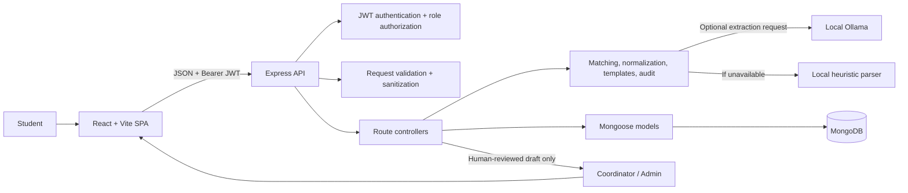
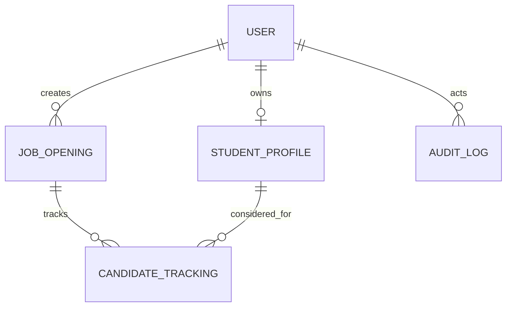

# CampusFlow AI Architecture

## System context

CampusFlow is a local-first web application with a React single-page frontend,
an Express JSON API, and MongoDB persistence through Mongoose. Coordinators
perform placement operations; student users maintain their own placement
profiles. The API integrates with local Ollama only for optional job
requirement extraction. Candidate communication messages are generated from
local templates and are not sent by the system.



## Runtime entry points

- `client/src/main.jsx` mounts React within `BrowserRouter`.
- `client/src/App.jsx` defines routes, role checks, the shared CampusFlow
  navigation, and role-specific dashboard routing.
- `client/src/api/apiClient.js` centralizes the API base URL and adds the JWT
  from local storage to requests.
- `server/src/server.js` loads environment variables, connects to MongoDB, and
  starts the HTTP server only after a successful database connection.
- `server/src/app.js` configures Helmet, CORS, body parsing, request logging,
  sanitization, API routers, health, 404 handling, and the final error handler.

## Backend request path

1. Express receives a request below `/api`.
2. Global middleware applies security headers, configured CORS, JSON/urlencoded
   parsing, logging, and recursive removal of MongoDB operator/dotted keys
   from request objects.
3. A route applies authentication where required. `authMiddleware` verifies
   the bearer JWT and attaches its user ID and role to `req.user`.
4. Role middleware blocks disallowed roles. Express-validator checks route
   parameters, request bodies, and supported query fields; the shared
   validation middleware returns structured 400 responses for invalid input.
5. A controller coordinates Mongoose reads/writes and domain services.
6. The controller returns a JSON response envelope, CSV attachment, or passes
   errors to the centralized error handler.

Authentication and role authorization are deliberately separate:
authentication identifies the account, while authorization checks whether its
role may perform a route's operation. Public registration always creates a
student; the role is not selected by the caller.

## Frontend route/access map

| Route | Access | Page |
|---|---|---|
| `/` | Public | Redirects to dashboard if a token exists, otherwise login |
| `/login`, `/register` | Signed-out only | Login and student registration |
| `/dashboard` | Signed in | Routes admin/coordinator to coordinator dashboard and students to student dashboard |
| `/student/profile` | Student | Create/update own student profile |
| `/jobs/create` | Admin/coordinator | Create job |
| `/jobs/:jobId/review-requirements` | Admin/coordinator | Review extraction and approve requirements |
| `/jobs/:jobId/matches` | Admin/coordinator | Review match results and candidate tracking |

The shared brand links to `/`; route guards redirect users to login or their
dashboard when access is not allowed. Role state is currently stored beside
the JWT in browser local storage; authorization is still enforced by the API.

## Main domain workflows

### Student onboarding

1. `POST /api/auth/register` validates name/email/password, hashes the
   password with bcryptjs, and creates a `STUDENT` user.
2. The student logs in; the API signs a JWT carrying `userId` and `role`.
3. `POST /api/students/profile` creates one profile for the authenticated
   student. `GET` and `PATCH /api/students/profile` are scoped to that
   authenticated user's ID, not an arbitrary user ID from the request.

### Job requirements

1. A coordinator creates a job with metadata, initial known requirements, and
   optional top-level matching rules.
2. `POST /api/jobs/:jobId/extract-requirements` asks Ollama to return
   structured JSON. A local parser is used if the service fails or is
   unavailable. The extraction controller normalizes that output and returns
   it without saving it as approved criteria.
3. The frontend merges extracted suggestions with requirements explicitly
   entered at job creation and renders them for review.
4. `POST /api/jobs/:jobId/approve-requirements` normalizes the submitted fields,
   persists them in `extractedRequirements`, sets status to `OPEN`, and writes
   an audit event. Top-level matching rules remain separate from extracted
   requirements.

This is a human-in-the-loop boundary: model output can be incomplete or
ambiguous, and coordinator approval is required before it becomes the job's
approved requirements.

### Matching

`GET /api/jobs/:jobId/matches` loads the job and student profiles, then invokes
the pure JavaScript `checkEligibility` function once per profile. The response
contains each student's identity/profile subset, `eligible`, human-readable
`reasons`, `failures`, `missingSkills`, and existing per-job tracking.

Matching is deterministic and explainable, not AI-generated:

1. Each configured branch, minimum CGPA, and graduation year constraint must
   pass.
2. Skill values are lowercased, common punctuation/separators are normalized,
   whitespace is tokenized, and duplicates are removed. Thus entered order and
   case do not affect matching. Examples of canonicalized skill names include
   `node.js`/`NodeJS` and `C#`/`csharp`.
3. With configured `matchingRules`, every must-have skill is mandatory. For
   preferred skills, the matched count divided by the number configured must
   be strictly greater than `preferredSkillThreshold` (default `0.5`).
4. For a legacy job without configured skill lists, flat
   `extractedRequirements.skills` is treated as the preferred-skill list using
   the default 0.5 threshold.
5. Eligibility requires no failures and at least one passing reason. Empty
   requirements therefore do not produce an automatic positive match.

The service returns explanations from the same checks that determine
eligibility, reducing divergence between the decision and its explanation.

### Candidate workflow and communication

`CandidateTracking` stores a unique job/profile pair. Coordinators update
pipeline stage (`SHORTLISTED`, `CONTACTED`, `INTERVIEW`, `OFFER`, `REJECTED`)
and feedback (`USEFUL`/`INCORRECT`, optionally with a reason). One candidate
record may also hold a communication type, subject, draft, status (`DRAFT` or
`SENT`), and update timestamp.

Communication templates are local functions in
`server/src/services/communicationService.js`. The single-draft compatibility
endpoint returns a subject and body without storing tracking. The batch
candidate endpoint builds the same templates with each student's/job context
and persists the draft. Coordinators may edit the body and mark the draft sent.
This records coordinator intent only; there is no SMTP/provider integration,
mail-app connection, or delivery confirmation.

### CSV and audit

- CSV import accepts CSV text in a JSON request, matches rows to existing
  student accounts by normalized email, and upserts profiles. It reports
  row-level validation/account errors while continuing valid rows.
- CSV export serializes profiles and populated account email to a downloadable
  CSV file. CSV fields are quoted/escaped when required.
- Audit events record job creation/update/deletion, requirement approval,
  candidate changes, communication draft/edit/sent operations, and CSV import.
  The audit controller returns up to the latest 100 events for a job.

## Data model map



Collection details, field constraints, indexes, and lifecycle are in
[database.md](database.md).

## Status and deadline behavior

Job status values are `DRAFT`, `REQUIREMENTS_PENDING_REVIEW`, `OPEN`, `CLOSED`,
and `ARCHIVED`. Requirement approval sets `OPEN`. Job listing and retrieval
close `OPEN` jobs whose deadlines fall before the current UTC day; the
dashboard presents closed jobs as closed. This is request-triggered status
maintenance rather than a scheduled background worker.

## Failure handling and external dependencies

- MongoDB connection failure stops API startup; database connection errors
  are logged.
- Route/controller errors reach a global handler which maps validation,
  duplicate-key, and invalid-ID errors to client responses and logs unexpected
  errors.
- Ollama extraction errors are logged and use the local fallback parser. The
  parser is heuristic and its results must be reviewed.
- Template communication needs no network service. Template type errors are
  explicit.
- Audit logging follows the existing audit service's best-effort behavior;
  failures are logged instead of rolling back the primary operation.

## Security and operational boundaries

- Passwords are bcrypt-hashed; the password hash field is excluded from normal
  User queries.
- JWT signatures and expiry are configured through environment variables.
- API routes combine authentication, role checks, validation, Helmet, CORS,
  and MongoDB operator/dotted-key sanitization.
- `JWT_SECRET` must be unique and secret outside tests/local demos. The seed
  password is for demo use only.
- The browser currently stores the JWT in local storage. Production hardening
  should assess HttpOnly cookies, CSRF strategy, rate limits, account recovery,
  deployment secret handling, monitoring, and data retention.
- Current scope is a single-tenant portfolio application. It does not model
  separate institutions or enforce tenant boundaries.

## Validation commands

```powershell
cd server
npm test
cd ..\client
npm run build
npm run lint
```
