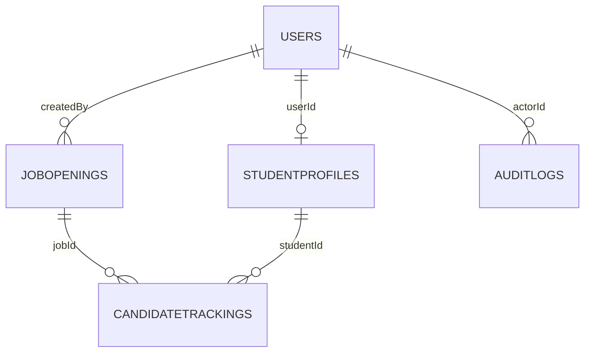
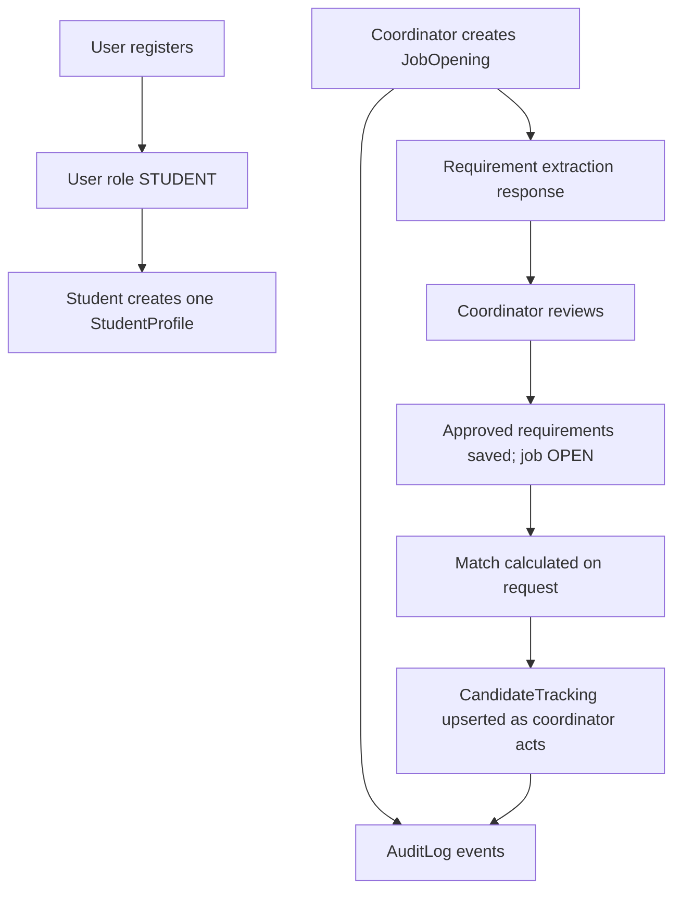

# CampusFlow AI Database Design

CampusFlow uses MongoDB through Mongoose. Collection names below are the
lowercase plural collection names derived from the Mongoose model names unless
an existing database has customized collection naming. All primary documents
use MongoDB `_id` ObjectIds. Schemas with timestamps include `createdAt` and
`updatedAt`.

## Entity relationship

MongoDB references are stored as ObjectIds. They are populated only where a
request needs related fields; the database does not provide relational
foreign-key enforcement.

## Collections

### `users`

Model: `server/src/models/User.js`

| Field | Type | Rules / purpose |
|---|---|---|
| `_id` | ObjectId | Primary identifier |
| `name` | String | Required, trimmed, 2–100 characters |
| `email` | String | Required, trimmed, lowercased, unique |
| `passwordHash` | String | Required bcrypt hash; `select: false` |
| `role` | Enum | `ADMIN`, `COORDINATOR`, or `STUDENT`; defaults to `STUDENT` |
| `createdAt`, `updatedAt` | Date | Mongoose timestamps |

Public registration hard-codes role `STUDENT`; the API does not trust a
caller-supplied role. Login explicitly selects the password hash only to
compare it with the submitted password.

### `studentprofiles`

Model: `server/src/models/StudentProfile.js`

| Field | Type | Rules / purpose |
|---|---|---|
| `_id` | ObjectId | Profile identifier |
| `userId` | ObjectId → `User` | Required and unique; one profile per account |
| `fullName` | String | Required, trimmed, 2–100 characters |
| `branch` | String | Required, trimmed, max 100 characters |
| `graduationYear` | Number | Required integer at API boundary; 2000–2100 |
| `cgpa` | Number | Required; 0–10 |
| `skills` | String[] | Defaults to an empty array |
| `experience` | String | Optional, trimmed, max 2,000 characters |
| `resumeText` | String | Optional, trimmed, max 10,000 characters |
| `createdAt`, `updatedAt` | Date | Mongoose timestamps |

The API only allows a student to create/read/update their own profile. CSV
coordinator import matches by an existing student's user email and upserts
the profile fields `fullName`, `branch`, `graduationYear`, `cgpa`, and
`skills`; it does not touch user credentials or import experience/resume text.

### `jobopenings`

Model: `server/src/models/JobOpening.js`

| Field | Type | Rules / purpose |
|---|---|---|
| `_id` | ObjectId | Job identifier |
| `createdBy` | ObjectId → `User` | Required creator |
| `companyName` | String | Required, trimmed, max 150 characters |
| `title` | String | Required, trimmed, max 150 characters |
| `description` | String | Required, trimmed, max 10,000 characters |
| `deadline` | Date | Required |
| `status` | Enum | `DRAFT`, `REQUIREMENTS_PENDING_REVIEW`, `OPEN`, `CLOSED`, `ARCHIVED`; default `DRAFT` |
| `extractedRequirements` | Embedded object | Approved criteria (shape below) |
| `matchingRules` | Embedded object | Must-have/preferred skill behavior (shape below) |
| `createdAt`, `updatedAt` | Date | Mongoose timestamps |

`extractedRequirements` fields:

| Field | Type | Purpose |
|---|---|---|
| `skills` | String[] | Legacy/fallback flat skill requirements |
| `minCGPA` | Number | Optional; 0–10 |
| `branches` | String[] | Optional branch allowlist |
| `graduationYears` | Number[] | Optional graduating-year allowlist |
| `location` | String | Optional trimmed location |
| `workMode` | Enum | Optional `On-site`, `Remote`, or `Hybrid` |
| `additionalNotes` | String | Optional additional requirement notes |

Top-level `matchingRules`:

| Field | Type | Purpose |
|---|---|---|
| `mustHaveSkills` | String[] | Every listed skill must match |
| `preferredSkills` | String[] | Candidate must exceed the configured matched fraction |
| `preferredSkillThreshold` | Number | 0–1 ratio; defaults to `0.5`; matching is strict `>` |

Earlier application data may have stored matching rules inside
`extractedRequirements`. The matcher and edit form retain a compatibility
fallback for that legacy shape; newly created/edited jobs store rules at the
top level.

### `candidatetrackings`

Model: `server/src/models/CandidateTracking.js`

| Field | Type | Rules / purpose |
|---|---|---|
| `_id` | ObjectId | Tracking-record identifier |
| `jobId` | ObjectId → `JobOpening` | Required |
| `studentId` | ObjectId → `StudentProfile` | Required |
| `stage` | Enum | `SHORTLISTED`, `CONTACTED`, `INTERVIEW`, `OFFER`, `REJECTED` |
| `feedback` | Enum | `USEFUL` or `INCORRECT` |
| `feedbackReason` | String | Optional, max 1,000 characters |
| `communicationType` | Enum | `interview-invite`, `rejection`, `shortlist`, `general` |
| `communicationSubject` | String | Optional, max 300 characters |
| `communicationDraft` | String | Optional, max 10,000 characters |
| `communicationStatus` | Enum | `DRAFT` or `SENT` |
| `communicationUpdatedAt` | Date | Timestamp for communication changes |
| `createdAt`, `updatedAt` | Date | Mongoose timestamps |

There is a unique compound index on `{ jobId: 1, studentId: 1 }`, so there is
at most one current tracking record per job/profile pair. Stage, feedback,
and communication fields are optional properties of that record; a formal
student application entity is not currently modeled.

### `auditlogs`

Model: `server/src/models/AuditLog.js`

| Field | Type | Rules / purpose |
|---|---|---|
| `_id` | ObjectId | Event identifier |
| `actorId` | ObjectId → `User` | Required acting account |
| `action` | String | Required action code |
| `entityType` | String | Required model/category |
| `entityId` | ObjectId | Required affected entity identifier |
| `metadata` | Mixed | Optional event-specific structured details |
| `createdAt`, `updatedAt` | Date | Mongoose timestamps |

Job audit history associates direct `JobOpening` events with the job and
candidate events with a job ID stored in event metadata. The endpoint returns
the newest 100 matching events.

## Relationships and lifecycle

- Requirement extraction itself is advisory and is not stored as approval.
- Approving requirements replaces `extractedRequirements`, sets the job
  `OPEN`, and preserves top-level `matchingRules`.
- Matching results are computed on demand from current profiles and job rules;
  the complete match list is not a stored snapshot.
- Candidate tracking is created lazily when the coordinator records candidate
  data or generates a draft.
- Draft edits update the tracking document; marking sent changes its status.
- Deadline closure is performed when jobs are listed/read/updated; it is not
  maintained by a scheduled database job.
- Audit events are separate documents and are best-effort. The existing audit
  service logs audit-write failures rather than rolling back the primary
  operation.

## Indexes and uniqueness

- `users.email`: unique index from `unique: true`.
- `studentprofiles.userId`: unique index from `unique: true`.
- `candidatetrackings.{ jobId, studentId }`: unique compound index.
- Other access patterns currently use Mongoose query sorting/filtering without
  explicitly declared supporting indexes in these schemas. Production traffic
  should be profiled before adding indexes.

## Validation and privacy notes

- Mongoose schema rules provide persistence-level validation for important
  fields. Express-validator provides request-boundary validation.
- `passwordHash` is excluded from regular user reads and never included in
  authentication response objects.
- Student profile APIs scope reads and updates to the authenticated student.
- CSV export is available only to coordinator/admin roles and includes student
  names, contact email, branch, year, CGPA, and skills. Treat it as personal
  data: control access and avoid committing exported files.
- Audit metadata is flexible (`Mixed`). Keep it limited to operational
  information; avoid logging passwords, JWTs, or unnecessary resume text.

## Backup and migration considerations

This project does not currently include a migration framework or automated
backup procedure. Back up MongoDB before production changes. The compatibility
read path for older embedded `matchingRules` is intended to allow older job
documents to continue matching/editing; new writes use the top-level schema.
If the data is migrated, verify document counts and matching outcomes before
removing compatibility handling.
